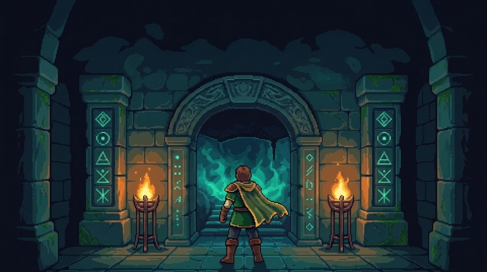

# Sanctum of Echoes

<p align="center">
  
</p>

An endless, procedurally generated 2D top-down dungeon adventure inspired by classic *The Legend of Zelda* (*A Link to the Past* / *The Minish Cap*), built with **SvelteKit 5**, **Phaser 3**, **TypeScript**, custom 16-bit pixel art, and a zero-dependency Web Audio API chiptune synthesizer.

## Highlights

| Feature | Details |
| --- | --- |
| **Infinite Procedural Floors** | Deterministic seeded generator (`Mulberry32`) with graph-based BFS solvability guarantees — the Floor Key is always reachable before the locked Exit Gate, and puzzles only require tools you already own. |
| **4 Cycling Biomes** | *Stone Sanctum*, *Ember Crypt*, *Verdant Ruins*, and *Astral Vault*, each with its own shaded 16-bit tileset palette and procedural chiptune soundtrack. |
| **Classic Zelda Puzzles & Action** | Pushable rune blocks (`[R]` to reset), blue/red crystal switch gates, brazier lighting, bombable cracked vaults, timed spike rings, barred combat ambushes, and an elite *Sanctum Guardian* every 3rd floor. |
| **Tools & Relics** | Unlock the **Gale Boomerang**, **Ember Rod**, and **Sanctum Bombs**, plus stackable relics (*Heart Vessel*, *Solar Edge*, *Gale Boots*, *Aegis Charm*, *Crimson Band*). |
| **Per-Floor Auto-Save** | Progress saves automatically to `localStorage` when entering each floor. Continue from your saved floor anytime, retry the current floor on defeat, or reset to Floor 1 whenever you choose. |
| **Multi-Language (EN / ES)** | Instant live language switcher in the Title Screen, HUD, and Pause menu (auto-detects browser language and supports `?lang=es` / `?lang=en`). |
| **Shareable Seeds** | Replay or share exact dungeon layouts via seed codes or URL params (`?seed=ECHO01&play=1`). |

## Controls

Both **WASD + Mouse** (cursor-aimed sword & tools) and **Keyboard-only** playstyles work seamlessly out of the box, with 130 ms input buffering and responsive touch controls on mobile devices.

| Action | Mouse + WASD | Keyboard Only |
| --- | --- | --- |
| Move & Push Blocks | `WASD` / `Arrow Keys` | `WASD` / `Arrow Keys` |
| Sword Slash / Open Chest | `Left Click` *(aims at cursor)* | `Space`, `Z`, or `J` |
| Use Equipped Tool | `Right Click` *(aims at cursor)* | `X`, `E`, `F`, or `L` |
| Dash Roll *(vaults 1-tile pits & spikes)* | `Shift` | `Shift`, `C`, or `K` |
| Switch Tool | `Mouse Wheel` or `1`–`3` | `1`–`3` or `Q` |
| Reset Push Blocks | `R` | `R` |
| Pause / Inventory | `Esc` or `P` | `Esc` or `P` |

## Local Development

```bash
pnpm install
pnpm dev          # Start local dev server (http://localhost:5173)
pnpm test         # Run unit tests (solvability, determinism, save validation)
pnpm check        # Svelte + TypeScript strict type checking
pnpm build        # Build static site into ./build
pnpm assets       # Regenerate pixel-art spritesheets (Python 3 + Pillow)
```

## AI Generation & Session Metrics

This project was designed, coded, verified, and refined interactively using **Google Antigravity**.

| Metric | Value |
| --- | --- |
| **Primary Model** | `Gemini 4 Neon (High)` |
| **Title Illustration** | Generated via Antigravity `image-generator` subagent (`static/assets/title-art.png`) |
| **Sprites & Tilesets** | Programmatically rendered 16-bit PNG sheets (`scripts/generate-assets.py`) |
| **Audio** | Synthesized in real time via Web Audio API (`src/lib/game/audio.ts`) |
| **Session Tokens (Main Agent, 49 steps)** | `586,313` uncached input · `194,204` output (`6,973,808` prompt cache reads) |
| **Session Tokens (Image Subagent, 5 steps)** | `26,604` uncached input · `3,774` output (`10,314` prompt cache reads) |
| **Combined Total (up to release prep)** | **`810,895` uncached + output tokens** (`7,795,017` total including prompt cache reads) |

> *Note: Token metrics reflect the recorded conversation transcript across design, full implementation, visual QA, control tuning, EN/ES localization, dash bugfix, and per-floor auto-save, measured right before the final documentation & GitHub Actions commit.*
